# Time Series Analysis and Forecasting of Monthly Airline Passengers (1949-1960)

**Mini Project - Statistical Methods (SM), TY BTech**

Python | pandas | statsmodels | matplotlib

---

## 1. Aim

To perform a complete **time series analysis** on a real monthly dataset: identify
its components (trend, seasonality, irregular), test it for stationarity, identify
a suitable model from its autocorrelation structure, compare classical forecasting
methods on held-out data, check the best model's residuals, and forecast the next
24 months with confidence intervals.

## 2. Description

A *time series* is a sequence of observations recorded at equal time intervals.
Unlike ordinary data, the observations are not independent: this month's value
depends on previous months. Time series analysis uses this dependence to
describe the past and forecast the future.

This project works through the full Box-Jenkins workflow on the classic *Air
Passengers* series:

1. Load and clean the data, compute summary statistics and plot the series
2. Rolling statistics, seasonal decomposition (additive, multiplicative, STL) and seasonal plots
3. Stationarity tests (ADF and KPSS), log transform, regular and seasonal differencing
4. ACF/PACF plots and model order identification
5. Train/test split (last 24 months as test), then seven forecasting models
6. Residual diagnostics (residual plot, histogram, Q-Q plot, ACF, Ljung-Box test)
7. Model evaluation with MAE, RMSE and MAPE
8. Refit the best model on all data and forecast 1961-1962
9. Conclusions

## 3. Dataset

| Item | Detail |
|---|---|
| Name | International Airline Passengers (Box & Jenkins "Series G") |
| Variable | Monthly total of international airline passengers, in **thousands** |
| Period | January 1949 to December 1960 |
| Observations | 144 (12 years x 12 months), no missing values |
| File | `data/AirPassengers.csv` (columns `Month`, `Passengers`) |
| Original source | Box, G.E.P., Jenkins, G.M. & Reinsel, G.C. *Time Series Analysis: Forecasting and Control*, Series G (1976). Also bundled with R as `datasets::AirPassengers`. |
| Download URL | <https://raw.githubusercontent.com/jbrownlee/Datasets/master/airline-passengers.csv> |

It was chosen because it is the textbook example of a series with **both trend and
seasonality**, and because the variance grows with the level, which makes it a
good case for log transforms and multiplicative models.

**Summary statistics (thousand passengers)**

| Statistic | Value | | Statistic | Value |
|---|---|---|---|---|
| Mean | 280.30 | | Minimum | 104 (Nov 1949) |
| Standard deviation | 119.97 | | Maximum | 622 (Jul 1960) |
| Median | 265.50 | | Skewness | 0.58 |
| Q1 / Q3 | 180.0 / 360.5 | | Coefficient of variation | 42.8 % |

The yearly total rose from 1,520 thousand (1949) to 5,714 thousand (1960), a
3.8x increase. Growth was positive every year (3.4 % to 21.8 % per year). The year-wise
table is saved in `outputs/yearly_statistics.csv`.

## 4. Methodology (theory)

### 4.1 Components of a time series

| Component | Meaning | In this data |
|---|---|---|
| Trend (T) | long-term upward/downward movement | steady growth of air travel |
| Seasonality (S) | pattern repeating with a fixed period (here 12 months) | summer holiday peak (Jul-Aug) |
| Cyclical (C) | rises and falls longer than a year with no fixed period | not visible in 12 years |
| Irregular / residual (R) | random noise left after removing the above | small |

* **Additive model:** Y = T + S + R. Use it when the seasonal swing is constant.
* **Multiplicative model:** Y = T x S x R. Use it when the seasonal swing grows with the level.
  Taking logs turns a multiplicative model into an additive one: log Y = log T + log S + log R.
* **STL** (Seasonal-Trend decomposition using LOESS) is a robust, non-parametric
  decomposition that lets the seasonal pattern change slowly over time.

### 4.2 Stationarity

A series is (weakly) **stationary** if its mean, variance and autocovariance do not
change over time. ARIMA models require a stationary series. Common fixes:

* **Log transform** to stabilise variance that grows with the level
* **First difference** (Y_t - Y_(t-1)) to remove a trend
* **Seasonal difference** (Y_t - Y_(t-12)) to remove a stable seasonal pattern

### 4.3 ADF and KPSS tests

| Test | Null hypothesis H0 | Stationary if |
|---|---|---|
| Augmented Dickey-Fuller (ADF) | series has a unit root (non-stationary) | p < 0.05 (reject H0) |
| KPSS | series is stationary | p >= 0.05 (do not reject H0) |

The two tests have opposite null hypotheses, so we use both. We call a series
stationary only when ADF rejects **and** KPSS does not reject.

### 4.4 ACF and PACF

* **ACF** (autocorrelation function): correlation between Y_t and Y_(t-k) for each lag k.
* **PACF** (partial ACF): correlation at lag k after removing the effect of lags 1..k-1.
* Identification rules: AR(p) means the PACF cuts off after lag p and the ACF tails off.
  MA(q) means the ACF cuts off after lag q and the PACF tails off. Spikes at
  lags 12, 24, ... point to seasonal AR (P) or MA (Q) terms.
* Bars outside the band +/- 1.96/sqrt(n) are significant at the 5 % level.

### 4.5 ARIMA and SARIMA

**ARIMA(p, d, q)**: an AutoRegressive model of order p on the series differenced d
times, plus Moving-Average terms of order q:

    (1 - phi_1 B - ... - phi_p B^p) (1 - B)^d Y_t = (1 + theta_1 B + ... + theta_q B^q) e_t

where B is the backshift operator (B Y_t = Y_(t-1)) and e_t is white noise.

**SARIMA(p, d, q)(P, D, Q)[s]** adds seasonal AR/MA polynomials in B^s and seasonal
differencing (1 - B^s)^D. Here s = 12. The well-known **"airline model"** is
SARIMA(0,1,1)(0,1,1)[12]. Orders are chosen with the **AIC** (Akaike Information
Criterion = 2k - 2 ln L), which balances goodness of fit against the number of
parameters k. Lower is better.

### 4.6 Exponential smoothing and Holt-Winters

* **Simple exponential smoothing (SES):** level_t = alpha Y_t + (1 - alpha) level_(t-1). It gives a flat forecast and suits data with no trend and no seasonality.
* **Holt-Winters (triple exponential smoothing / ETS):** three smoothing equations, for level (alpha), trend (beta) and seasonality (gamma). The multiplicative-seasonal version forecasts (level + h x trend) x seasonal index.
* **Baselines:** *naive* (repeat the last value), *seasonal naive* (repeat the value from the same month last year) and *moving average* (mean of the last 12 months). A useful model must beat these.

### 4.7 Error metrics

| Metric | Formula | Notes |
|---|---|---|
| MAE | (1/n) sum of abs(y_t - yhat_t) | average error, same unit as the data |
| RMSE | sqrt( (1/n) sum of (y_t - yhat_t)^2 ) | penalises large errors more |
| MAPE | (100/n) sum of abs( (y_t - yhat_t) / y_t ) | percentage error, scale-free |

### 4.8 Residual diagnostics

The residuals of an adequate model should be **white noise**: mean about 0, constant
variance, roughly normal and uncorrelated. We check this with a residual plot, a
histogram, a normal Q-Q plot, the residual ACF and the **Ljung-Box test**
(H0: no autocorrelation up to lag h; p > 0.05 means the model is adequate).

## 5. How to run

```bash
git clone https://github.com/chhelu123/time-series-forecasting.git
cd time-series-forecasting
pip install -r requirements.txt

# Option 1: plain script, writes every figure and table to outputs/
python src/analysis.py

# Option 2: open the notebook (already executed, all outputs saved)
jupyter notebook time_series_analysis.ipynb
```

Run time is about 1 minute (most of it is the SARIMA grid search).

**Project structure**

```
time-series-forecasting/
|-- data/AirPassengers.csv            dataset
|-- src/analysis.py                   full pipeline as a script
|-- time_series_analysis.ipynb        same pipeline, executed notebook
|-- outputs/
|   |-- figures/*.png                 15 figures
|   |-- metrics.csv                   MAE / RMSE / MAPE of all models
|   |-- stationarity_tests.csv        ADF + KPSS results
|   |-- sarima_grid_search.csv        AIC of all 36 SARIMA models
|   |-- forecast_next_24_months.csv   forecast with 80 % / 95 % intervals
|   `-- ...                           summary stats, Ljung-Box tables
|-- report/report.html                printable report (source of REPORT.pdf)
|-- REPORT.pdf
`-- README.md                         this report
```

## 6. Key code snippets

**Loading the data with a monthly DatetimeIndex**

```python
df = pd.read_csv(DATA)
df["Month"] = pd.to_datetime(df["Month"], format="%Y-%m")
df = df.drop_duplicates("Month").set_index("Month").sort_index()
y = df["Passengers"].asfreq("MS").astype(float)   # MS = month-start frequency
```

`asfreq("MS")` fixes the frequency. Any missing month would appear as NaN, which
lets us verify that the series is complete (it is: 0 missing values).

**Decomposition**

```python
dec_add = seasonal_decompose(y, model="additive", period=12)
dec_mul = seasonal_decompose(y, model="multiplicative", period=12)
stl = STL(np.log(y), period=12, robust=True).fit()
```

**ADF + KPSS in one function**

```python
def stationarity(series, name):
    s = series.dropna()
    adf_stat, adf_p, *_ = adfuller(s, autolag="AIC")
    kpss_stat, kpss_p, *_ = kpss(s, regression="c", nlags="auto")
    adf_ok, kpss_ok = adf_p < 0.05, kpss_p >= 0.05   # both must agree
    ...

d1_12 = np.log(y).diff().diff(12)    # log + first + seasonal difference
```

**SARIMA order selection by AIC grid search (on log scale)**

```python
for p, q, P, Q in itertools.product(range(3), range(3), range(2), range(2)):
    res = SARIMAX(np.log(train), order=(p, 1, q),
                  seasonal_order=(P, 1, Q, 12)).fit(disp=False)
    sarima_grid.append({"order": (p, 1, q), "seasonal_order": (P, 1, Q, 12),
                        "AIC": res.aic})
# forecasts are transformed back with exp()
forecast = np.exp(sarima.get_forecast(24).predicted_mean)
```

**Holt-Winters (additive trend, multiplicative seasonality)**

```python
hw = ExponentialSmoothing(train, trend="add", seasonal="mul",
                          seasonal_periods=12,
                          initialization_method="estimated").fit()
forecast = hw.forecast(24)
```

**Evaluation metrics**

```python
def metrics(actual, pred):
    e = actual - pred
    return {"MAE": np.mean(np.abs(e)),
            "RMSE": np.sqrt(np.mean(e ** 2)),
            "MAPE (%)": 100 * np.mean(np.abs(e / actual))}
```

**Residual diagnostics: Ljung-Box**

```python
lb = acorr_ljungbox(resid, lags=[6, 12, 18, 24], return_df=True)
```

## 7. Output and interpretation

### 7.1 The series

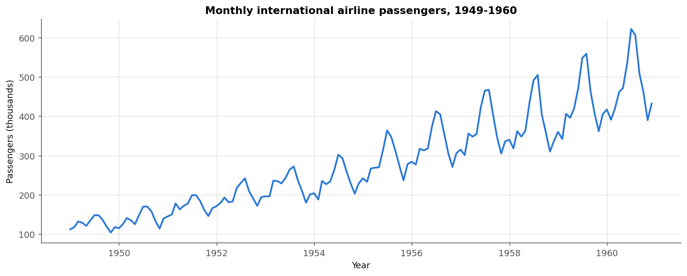

The series shows a clear **upward trend** and a **12-month seasonal cycle**, and the
seasonal swings become wider as the level rises.

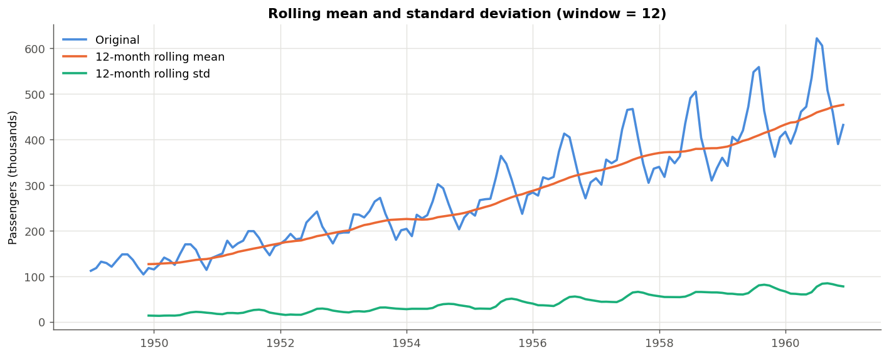

The 12-month rolling mean rises steadily. The rolling standard deviation rises from
13.7 (1949) to 77.7 (1960). Because both the mean and the variance change, the
series is **not stationary**.

### 7.2 Decomposition

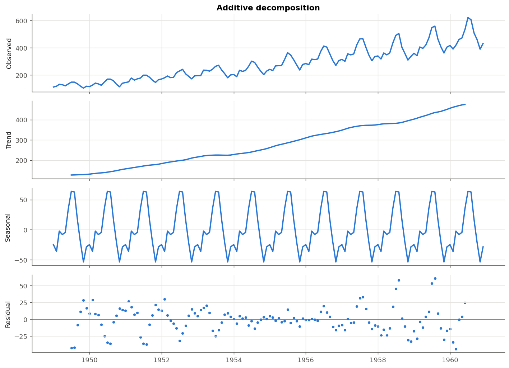

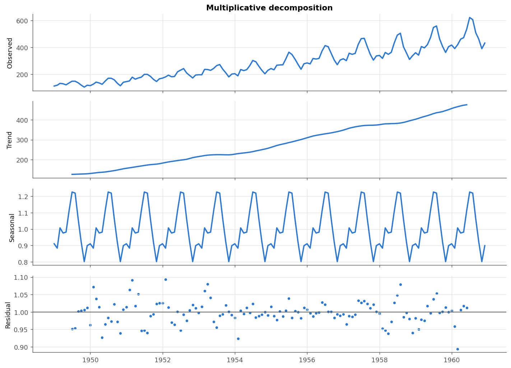

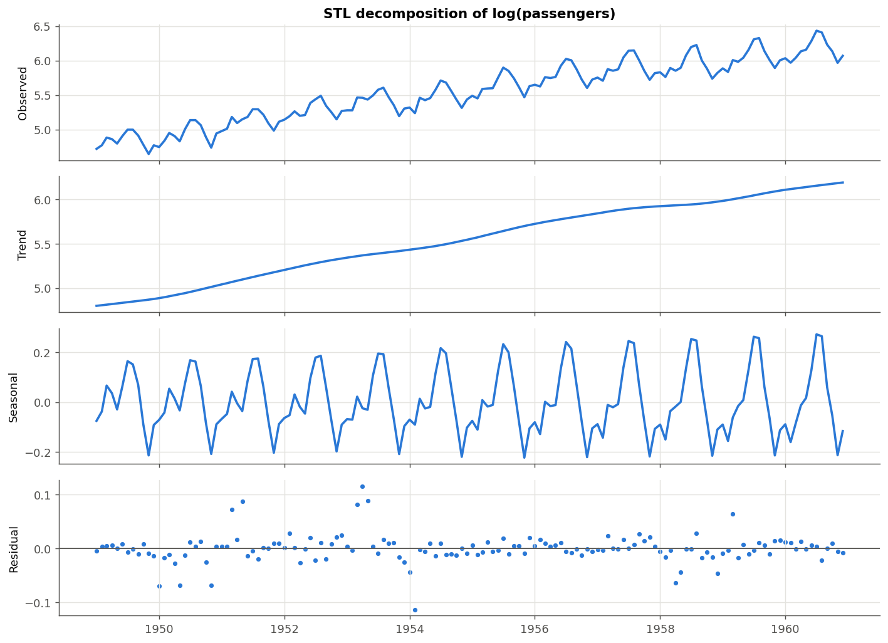

* The **additive** residuals still contain a seasonal pattern that is large at
  both ends of the series (lag-1 autocorrelation 0.67). A fixed seasonal amount
  cannot describe swings that keep growing.
* The **multiplicative** residuals are smaller and less structured (lag-1
  autocorrelation 0.40). The seasonal indices are Jul 1.227, Aug 1.220 and Nov 0.801:
  July traffic is about 23 % above an average month and November about 20 % below.
* **STL on log(Y)** gives a strength of trend of 0.996 and a strength of seasonality
  of 0.959 (both on a 0-1 scale), so both components are very strong.

### 7.3 Seasonality

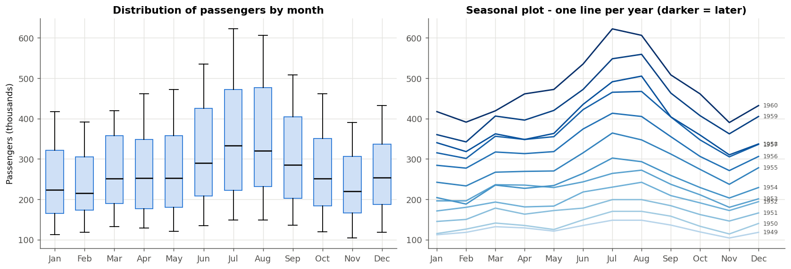

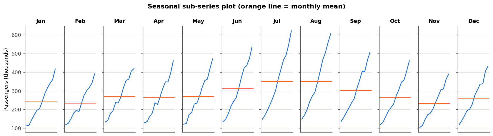

July and August are the busiest months in every year and November is the
quietest. The year lines are stacked almost in order, and only 1957 and 1958
overlap (1958 had the weakest growth). The *shape* of the season is stable while
its *level* rises. Each month's sub-series rises steadily (trend).

### 7.4 Stationarity tests

| Series | ADF stat | ADF p | KPSS stat | KPSS p | Conclusion |
|---|---|---|---|---|---|
| Original Y | 0.815 | 0.9919 | 1.651 | 0.01 | Non-stationary |
| log(Y) | -1.717 | 0.4224 | 1.669 | 0.01 | Non-stationary |
| log(Y), 1st difference | -2.717 | 0.0711 | 0.038 | 0.10 | Inconclusive |
| log(Y), seasonal difference | -2.710 | 0.0724 | 0.292 | 0.10 | Inconclusive |
| **log(Y), 1st + seasonal difference** | **-4.443** | **0.0002** | **0.073** | **0.10** | **Stationary** |

(KPSS p-values are interpolated from a table and capped at 0.01 and 0.10.)

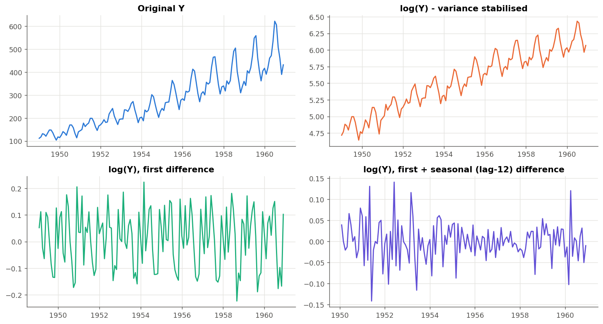

The log transform makes the seasonal swings equal in size, but the trend remains.
A single difference of either kind is not enough: ADF p is about 0.07. Only after
one regular **and** one seasonal difference do both tests agree that the series
is stationary. This gives **d = 1, D = 1, s = 12**.

### 7.5 ACF / PACF and model identification

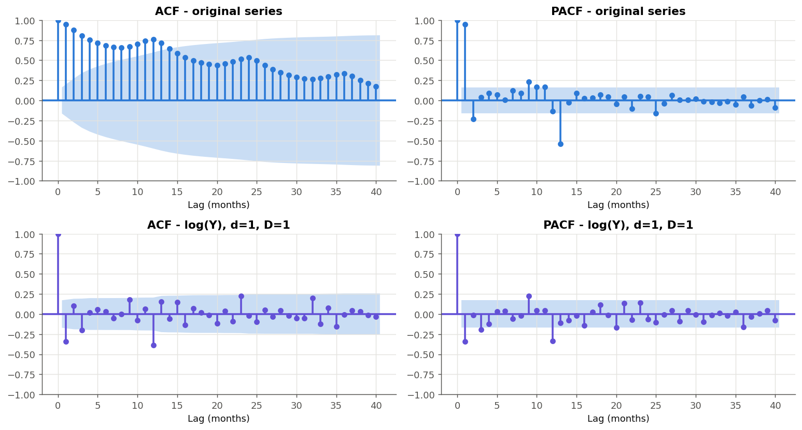

* The ACF of the original series decays very slowly, with bumps at 12, 24 and 36.
  This is the typical signature of a trend plus seasonality (non-stationary).
* For the stationary series log(Y) with d = 1 and D = 1, the largest ACF spikes are at **lag 1 (-0.34)**
  and **lag 12 (-0.39)**. Smaller spikes at lags 3, 9 and 23 (|r| about 0.2) only just
  cross the significance band (+/- 0.17). The PACF decays at the start of the series and
  again around lag 12.
* A single negative ACF spike at lag 1 suggests a non-seasonal MA(1), and a negative spike at
  lag 12 suggests a seasonal MA(1). The tentative model is **SARIMA(0,1,1)(0,1,1)[12]**.

The AIC grid search over 36 candidate models (p, q = 0..2; P, Q = 0..1) selected
the same model:

| order | seasonal order | AIC |
|---|---|---|
| **(0,1,1)** | **(0,1,1)[12]** | **-389.01** |
| (1,1,0) | (0,1,1)[12] | -388.64 |
| (1,1,1) | (0,1,1)[12] | -387.28 |
| (0,1,1) | (1,1,1)[12] | -387.22 |

Fitted coefficients on 1949-1958: MA(1) theta = -0.342 (p < 0.001) and seasonal
MA(1) Theta = -0.541 (p < 0.001). Both are significant.

The non-seasonal **ARIMA** grid (p, q = 0..3, d = 1) selected ARIMA(3,1,3). The
Holt-Winters variant with the lowest AIC was **additive trend + multiplicative
seasonality**, undamped (AIC 571.6, against 619.4 for additive seasonality). Its
parameters were alpha = 0.364, beta = 0.000 and gamma = 0.636.

### 7.6 Model comparison (test set: Jan 1959 to Dec 1960, 24 months)

| Rank | Model | MAE | RMSE | MAPE (%) |
|---|---|---|---|---|
| 1 | **Holt-Winters (add. trend, mul. season)** | **28.98** | **32.49** | **6.39** |
| 2 | SARIMA(0,1,1)(0,1,1)[12] | 39.44 | 43.18 | 8.52 |
| 3 | Seasonal naive | 71.25 | 77.00 | 15.52 |
| 4 | ARIMA(3,1,3) | 70.70 | 92.44 | 14.09 |
| 5 | Moving average (12) | 77.83 | 103.22 | 15.47 |
| 6 | Naive | 115.25 | 137.33 | 23.58 |
| 6 | Simple exponential smoothing | 115.25 | 137.33 | 23.58 |

(Saved as `outputs/metrics.csv`. MAE and RMSE are in thousand passengers.)

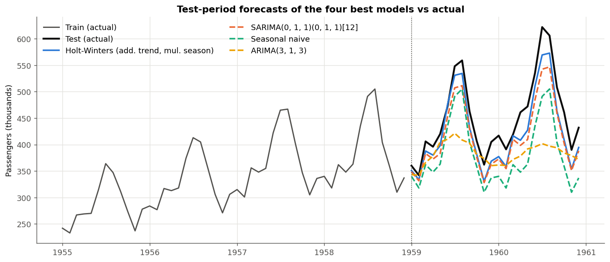

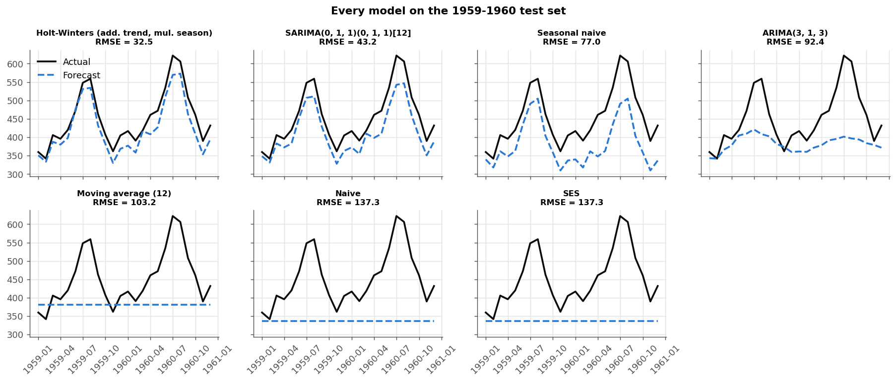

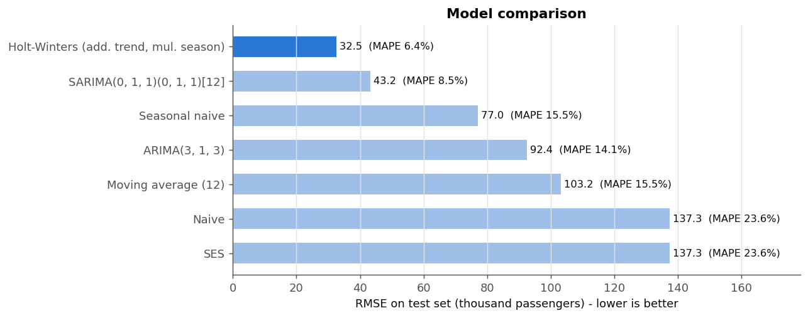

**Interpretation**

* **Holt-Winters** is the most accurate model. Its average error is about 29
  thousand passengers per month (6.4 %), less than half the seasonal-naive error.
* **SARIMA** is second (8.5 %). It reproduces the seasonal shape almost perfectly
  but sits slightly below the actual values. Growth in 1958 was weak (only +3.4 %),
  so a model trained up to 1958 projects a slower trend than the 11-12 % growth
  that followed in 1959-60.
* Models **without a seasonal component** (naive, SES, moving average, plain ARIMA)
  produce flat or smooth lines and cannot follow the summer peaks, so their errors
  are 2-4 times larger. SES estimated alpha = 1, which makes it identical to the naive
  forecast.
* Every seasonal model beats every non-seasonal one. Modelling seasonality is the
  single most important step for this data.

### 7.7 Residual diagnostics

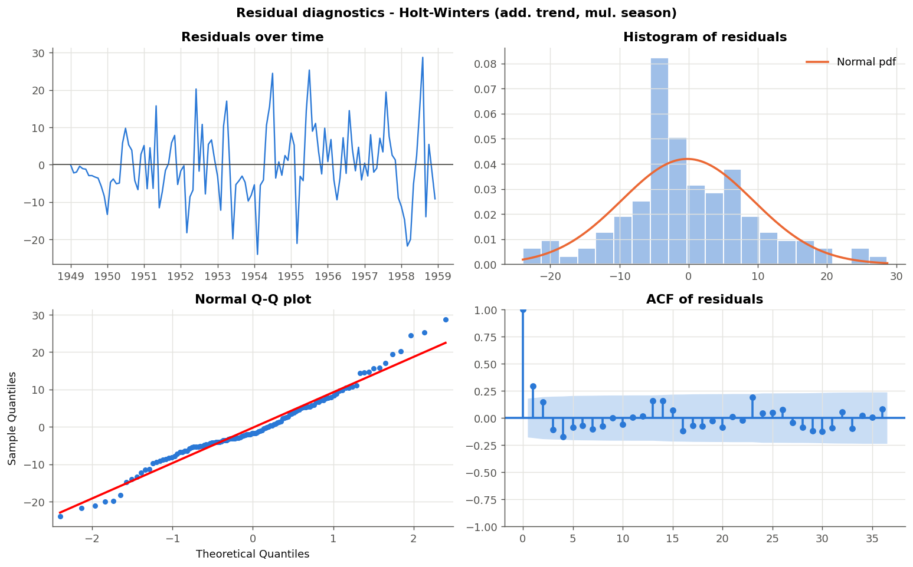

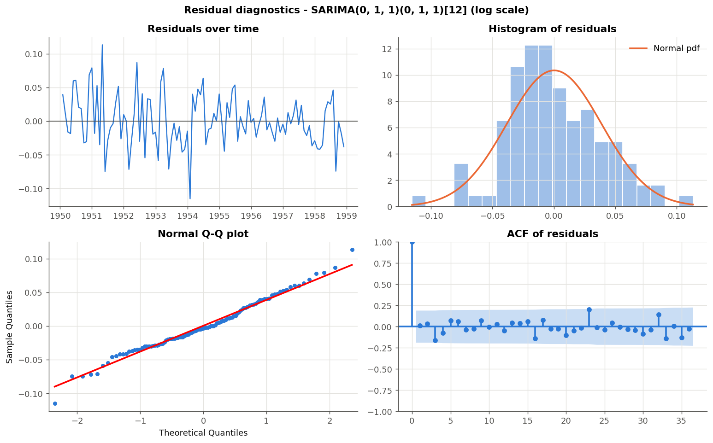

| Ljung-Box p-value at lag | 6 | 12 | 18 | 24 | Jarque-Bera p | Shapiro-Wilk p |
|---|---|---|---|---|---|---|
| Holt-Winters | 0.002 | 0.027 | 0.012 | 0.015 | 0.075 | 0.023 |
| SARIMA(0,1,1)(0,1,1)[12] | 0.559 | 0.912 | 0.914 | 0.804 | 0.578 | 0.487 |

* **SARIMA residuals are white noise.** All Ljung-Box p-values are > 0.05, no ACF
  bar is significant beyond chance, the Q-Q plot follows the line, and both normality
  tests pass. Statistically, the model is fully adequate.
* **Holt-Winters residuals** have mean about 0 and are close to normal (Jarque-Bera
  p = 0.075), but Ljung-Box rejects independence (p < 0.05). Some short-lag
  autocorrelation is left, and the residual spread grows with the level because they are on
  the original scale. The model forecasts well, but its prediction intervals should
  be read as approximate.

### 7.8 Forecast for 1961-1962

The best model on the test set (Holt-Winters) was re-estimated on all 144 months
and used to forecast 24 months ahead. Its 80 % and 95 % prediction intervals come from 5,000 simulated
future paths.

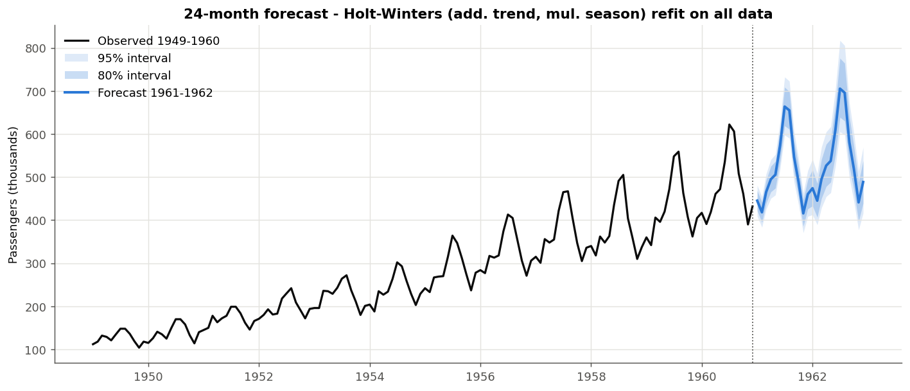

| Month | Forecast | 95 % interval | | Month | Forecast | 95 % interval |
|---|---|---|---|---|---|---|
| Jan 1961 | 445 | 409 - 481 | | Jan 1962 | 474 | 413 - 542 |
| Feb 1961 | 418 | 383 - 454 | | Feb 1962 | 445 | 389 - 508 |
| Mar 1961 | 465 | 425 - 508 | | Mar 1962 | 495 | 429 - 569 |
| Apr 1961 | 495 | 451 - 541 | | Apr 1962 | 527 | 455 - 605 |
| May 1961 | 506 | 458 - 553 | | May 1962 | 538 | 464 - 617 |
| Jun 1961 | 573 | 518 - 630 | | Jun 1962 | 610 | 525 - 704 |
| Jul 1961 | 664 | 597 - 732 | | Jul 1962 | 705 | 605 - 817 |
| Aug 1961 | 655 | 590 - 723 | | Aug 1962 | 696 | 598 - 805 |
| Sep 1961 | 547 | 489 - 606 | | Sep 1962 | 581 | 499 - 672 |
| Oct 1961 | 488 | 436 - 542 | | Oct 1962 | 519 | 444 - 601 |
| Nov 1961 | 416 | 371 - 464 | | Nov 1962 | 441 | 377 - 514 |
| Dec 1961 | 460 | 409 - 515 | | Dec 1962 | 489 | 416 - 569 |

* Forecast total for **1961: about 6,132 thousand** passengers (+7.3 % over 1960's 5,714 thousand).
  For **1962: about 6,518 thousand**.
* The peak forecast is **705 thousand in July 1962**. The seasonal pattern (Jul/Aug high,
  Nov low) is preserved.
* The intervals widen with the horizon because uncertainty accumulates.

## 8. Conclusion

1. The airline passenger series has a **strong upward trend** (STL strength 0.996)
   and a **strong, stable 12-month seasonality** (strength 0.959). The seasonality is
   **multiplicative**: July/August are about 22 % above average and November about 20 % below.
2. The raw series is **non-stationary** (ADF p = 0.99, KPSS p = 0.01). A **log transform
   plus one regular and one seasonal difference** makes it stationary (ADF p = 0.0002,
   KPSS p = 0.10).
3. The ACF/PACF of the stationary series and the AIC grid search both identify the
   Box-Jenkins **airline model SARIMA(0,1,1)(0,1,1)[12]**. Its residuals pass every
   diagnostic test (white noise, normal).
4. On the 24-month test set, **Holt-Winters with multiplicative seasonality was the
   most accurate model (MAE 28.98, RMSE 32.49, MAPE 6.39 %)**. SARIMA was second (MAPE 8.52 %).
   Both beat the seasonal naive baseline (MAPE 15.52 %) by a wide margin, and every model
   without seasonality performed poorly.
5. The best statistical fit (SARIMA, clean residuals) is not automatically the best
   forecaster. Out-of-sample testing is needed to choose a forecasting model.
6. The refitted Holt-Winters model forecasts continued growth of about 7 % in 1961,
   with a peak of about 705 thousand passengers in July 1962.

**Limitations and scope:** the dataset is short (12 years) and historical. The
forecasts assume that past trend and seasonality continue, and they do not include
external factors such as fares, economic conditions or major events. Further
work could add rolling-origin cross-validation, Box-Cox transforms, or
models such as Prophet or LSTM.

## 9. References

1. Box, G.E.P., Jenkins, G.M., Reinsel, G.C. (1976/2015). *Time Series Analysis: Forecasting and Control*. Wiley. (Series G: airline passengers)
2. Hyndman, R.J., Athanasopoulos, G. (2021). *Forecasting: Principles and Practice*, 3rd ed. OTexts. <https://otexts.com/fpp3/>
3. Seabold, S., Perktold, J. (2010). *statsmodels: Econometric and statistical modeling with Python*. <https://www.statsmodels.org/>
4. Dataset CSV: <https://raw.githubusercontent.com/jbrownlee/Datasets/master/airline-passengers.csv>
